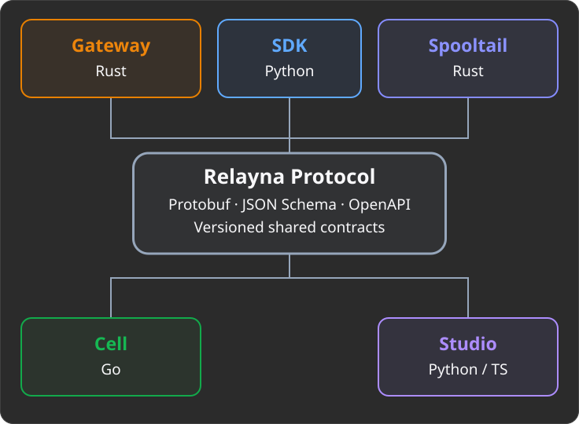

# relayna-protocol

Establish transport-independent contracts before implementing more integrations

## Core architecture

Relayna Protocol is the shared specification for the Relayna ecosystem.



## Protocol v1.0

The single-task profile specifies how Gateway, the Python SDK, Spooltail, and Studio exchange tasks, status, and results, with optional Cell execution correlation. Start with the [protocol guide](contracts/v1.0/README.md) or the [SDK service OpenAPI document](contracts/v1.0/openapi.yaml).

## Run Relayna locally

Use the [local quickstart](docs/quickstart.md) to install the reference stack with Compose or Helm, run an authenticated task, and replay it in Studio. The [documentation index](docs/index.md) links the component roles and [independent release channels](docs/components.md).

Build the documentation portal locally with `uvx --from mkdocs==1.6.1 mkdocs build --strict`.

## Verify the contracts

Run the contract checks with Python 3.12 or newer. The dependencies are for verification in a development environment.

```sh
python -m pip install -r tests/requirements.txt
python -m unittest discover -s tests -v
```
