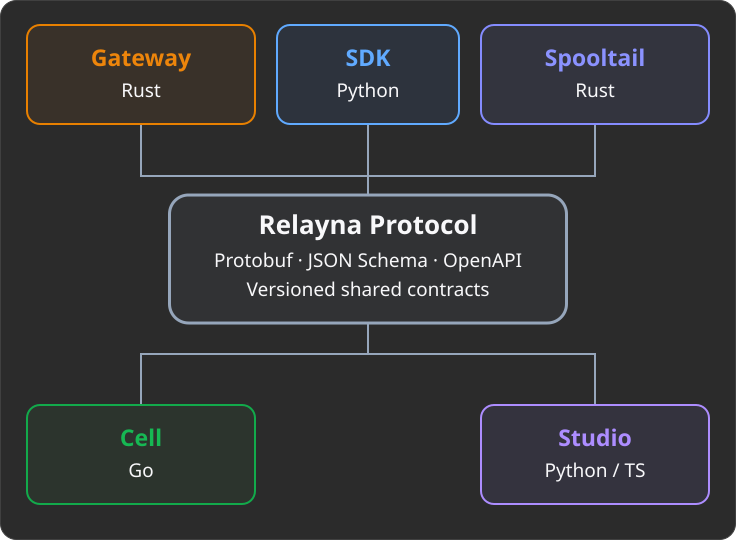

# Relayna ecosystem

Gateway applies caller policy and routes tasks to the registered service. The Python SDK publishes tasks and runs handlers. Spooltail owns the work journal and task results. Studio reads status and broker history through the SDK and can correlate Gateway usage. Standalone Cell can run a handler in gVisor and record scoped inference observations.

- [Local quickstart](quickstart.md)
- [Component releases and immutable image selection](components.md)
- [Protocol v1.0, JSON Schemas, and OpenAPI](https://github.com/sarattha/relayna-protocol/tree/main/contracts/v1.0)
